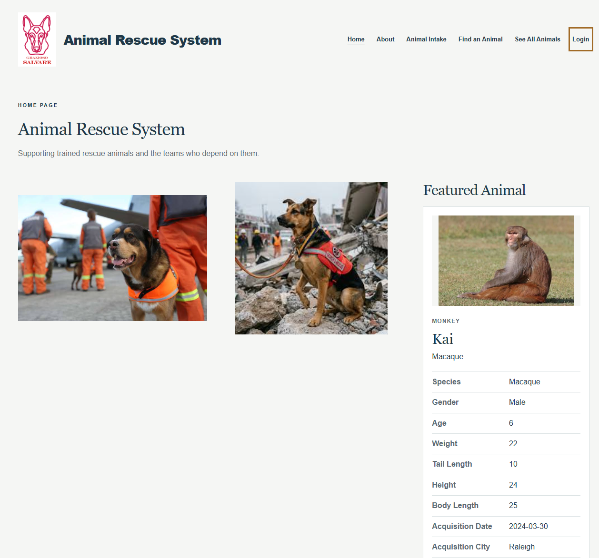
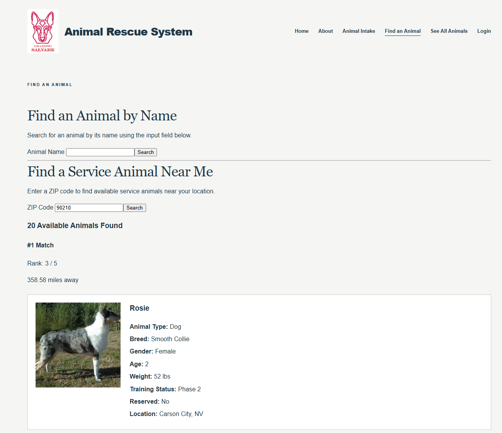
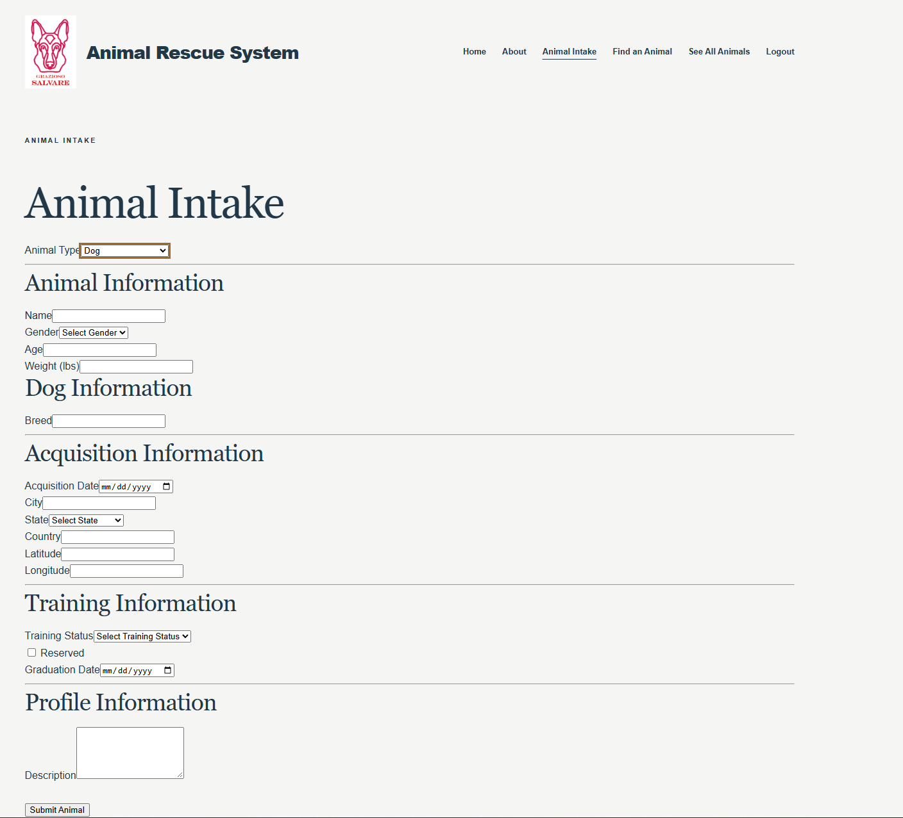

# Matthias Bradshaw | Computer Science ePortfolio

**Southern New Hampshire University — CS-499 Computer Science Capstone**
---

Welcome to my computer science ePortfolio. This portfolio documents my growth throughout SNHU's Bachelor of Science in Computer Science program, culminating in my transformation of an introductory Java rescue-animal terminal application from one of my first courses into a fullstack Animal Rescue Management System using all of the knowledge I have gained. It includes my professional self assessment, initial code review, original artifact, and enhancement through the three categories of software design and engineering, algorithms and data structures, and databases.


## Contents

1. [Professional Self-Assessment](#professional-self-assessment)
2. [Informal Code Review](#informal-code-review)
3. [Original Artifact and Project Overview](#original-artifact-and-project-overview)
4. [Enhancement One: Software Design and Engineering](#enhancement-one-software-design-and-engineering)
5. [Enhancement Two: Algorithms and Data Structures](#enhancement-two-algorithms-and-data-structures)
6. [Enhancement Three: Databases](#enhancement-three-databases)

---

# Professional Self-Assessment

  My computer science education at Southern New Hampshire University has changed the way I approach technical problems and my expectations for my professional future. Before pursuing the degree, I was interested in computers and enjoyed understanding how technology worked, but I did not have a clearly defined software development career path. My professional background is in municipal public works and has involved operating equipment, coordinating daily work, training and working closely with co-workers, and solving practical problems in the field. Those experiences taught me to weigh reliability, safety, efficiency, and the needs of the people who depend on a system. My coursework throughout my time at SNHU builds upon those skills in different manners and has allowed me to learn a new set of skills as well. I hope to put these new skills to good use by working on personal projects for myself and pivoting to a new career in software development.

  When I began my journey at SNHU, I had no prior coding experience. Even the basics of scripting in Python were new and challenging, and I had little understanding of development tools such as Git and GitHub. Since then, I have developed a strong foundation in computer science through hands on experience with programming languages including Python, C++, Java, JavaScript, and TypeScript. Throughout my coursework, I have gained experience in object oriented programming, data structures and algorithms, software design, and fullstack application development.

  I have learned to build applications using frameworks and technologies such as Angular, Express, and Node.js, while working with both SQL and NoSQL databases, including MongoDB. My projects have given me practical experience developing RESTful APIs, integrating frontend and backend systems, implementing authentication and authorization, and performing CRUD operations. I have also developed skills in unit testing, debugging, input validation, and secure coding practices, including using OWASP guidelines to identify potential vulnerabilities. Beyond writing code, I have become comfortable using Git and GitHub for version control and branch management, as well as Docker for containerization.

  My coursework has also strengthened my understanding of software engineering principles, including object oriented design, algorithm efficiency and Big-O notation, database modeling, and the software development life cycle. More importantly, I have learned how these concepts work together to create complete applications. Looking back at where I started, one of my greatest accomplishments is not simply learning new programming languages or technologies but developing the confidence and problem solving skills to approach unfamiliar challenges, research potential solutions, and independently design, build, test, and improve software.
  
  I'm used to working hand in hand with co-workers on a project where everyone has a role, and that's not so different to aspects related to developing code within a team of developers for an overall project goal. In my time at SNHU I saw firsthand what that would be like when working on my CS 310 jukebox application project with my fellow classmates. We used a collaborative environment with bitbucket to host a shared repository and developed a program using different branches, completing peer reviews and merges to create a final product that everyone had a hand in. This taught me valuable lessons in merge conflicts and effective communication with peers throughout the development life cycle.
  
  I've also learned a great deal about the software development life cycle at SNHU, specifically Agile development and the importance of working through smaller, iterative stages, completing goals one step at a time while laying the foundation for future development. This process is beneficial in several ways, as it allows larger goals to be broken down into manageable tasks and the workload to be distributed across a team. Beyond making complex projects more manageable, this approach also provides opportunities to evaluate how individual components work together, identify potential issues early, and ensure that each stage of development aligns with the overall project requirements. It also allows developers to incorporate feedback and make adjustments throughout the process rather than waiting until the project is complete. I applied this approach throughout my CS-499 capstone by building upon the same artifact across three enhancements, beginning with the software design, followed by algorithms and data structures, and finally database integration and authentication. Each enhancement built upon the previous work, allowing me to address challenges as they arose while gradually developing a more complete and functional application.

  To showcase my progress during my degree program at SNHU I've included an original artifact from one of my first courses in the computer science program. I took a project I worked on in IT 145 that was a terminal application for an animal rescue management system and enhanced it through three major categories of Software Design and Engineering, Algorithms and Data Structures, and Databases by turning it into a fullstack web application using the MEAN stack to showcase how far I have come. In the sections that follow you can read about the enhancements across each category, as well as watch the code review where I discuss the original artifact and my plans for enhancements.
  
---
# Informal Code Review

  You can check out my [code review](https://youtu.be/GWwUaSfZF6c) video on YouTube and see the analysis of the original artifact and the discussion about the planned enhancements. The main goals of the code review were to examine the existing functionality of the artifact, analyze the code for structure, inefficiencies, and documentation as well as discuss planned enhancements.

---
# Original Artifact and Project Overview

  The artifact I selected for my CS 499 capstone was the [Animal Rescue System](https://github.com/mattbradshaw22/IT-145) I originally developed in IT 145 Foundation in Application Development. This was one of my earliest programming projects at SNHU, making it an ideal choice to demonstrate how much my technical knowledge and software development skills have progressed throughout the Computer Science program.
  
  The original application was written in Java and operated entirely through a console based interface. It was designed to manage rescue animals, specifically dogs and monkeys, by allowing users to intake new animals, display lists of available animals, and reserve animals for service. The application used object oriented programming principles, including classes, inheritance, and collections, to organize animal information and manage the different operations.
  
  Although the original project accomplished its intended goals, it had several limitations. Animal records were stored in memory rather than in a persistent database, the interface was limited to console interaction, and the reservation functionality selected the first matching available animal without considering factors such as geographic proximity. The application also lacked user accounts, authentication, and an API that could support access from other systems.
  
  I chose to enhance this project across all three categories of my CS 499 capstone: Software Design and Engineering, Algorithms and Data Structures, and Databases. My goal was to transform a relatively simple Java application into a fullstack Animal Rescue Management System that would be more accessible, functional, and representative of modern software development practices.
  
  The enhanced application incorporates Angular, Express, Node.js, and MongoDB to provide an interactive web interface, persistent data storage, and RESTful API communication. Users can search for animals by name or geographic proximity, while registered users can log in and submit new animals through an intake form. The project demonstrates not only the technical skills I have developed at SNHU but also my ability to evaluate an existing solution, identify opportunities for improvement, and implement those improvements through iterative development.

---
# Enhancement One: Software Design and Engineering

  For my first enhancement, I focused on software design and engineering by converting the original Java console application into a fullstack web application. This was a significant change in the project's architecture, moving from a program that operated entirely through the terminal to one that users could access and interact with through a web browser.

  I used Express and Node.js to establish the backend web application and created pages for the homepage, animal listings, and information about the rescue system. I also incorporated Angular components for more interactive functionality, including the animal intake and search pages. One of my main design goals was to maintain a consistent user experience throughout the application while keeping the code organized and reusable.

  Here are some images of the main aspects I designed and engineered of the web application.
  
  
  
  
  One of the biggest challenges I encountered was integrating the Angular single page application into the existing Express website. Rather than recreating the navigation bar, header, and footer separately for Angular, I wanted the Angular components to display within the Express page structure. This required me to learn more about routing, frontend integration, and how the two frameworks could work together without unnecessarily duplicating code.
I also developed an animal intake form with input validation to help ensure that submitted information followed the expected data structure. This was important preparation for the database integration I planned to complete in later enhancements. By considering the requirements of future functionality early in development, I was able to establish a foundation that could support additional features without completely redesigning the application.
  
  This enhancement demonstrated my understanding of software architecture, frontend and backend development, component based design, and iterative problem solving. I also used GitHub branches to organize my development work, which allowed me to implement and review changes in smaller stages. Overall, the first enhancement established the foundation for the remaining portions of my capstone and demonstrated my ability to take an existing application and redesign it using technologies and practices I learned throughout the Computer Science program.

---
# Enhancement Two: Algorithms and Data Structures

  For my second enhancement, I focused on algorithms and data structures by improving how users could search for and identify suitable rescue animals. In the original Java application, the reservation functionality simply searched through the animal collection until it found the first matching animal that was not already reserved. While this approach worked for the original requirements, it did not consider whether an animal was geographically close to the user or provide a way to compare multiple possible matches.
  
  I enhanced the application by implementing a “search by name” feature and a nearby animal search that uses geographic coordinates to determine the distance between a user's location and the animals stored in the database. I also added functionality to display a randomly selected animal on the homepage. The nearby search required several steps. First, I used the JavaScript zipcodes package to convert a user entered ZIP code into latitude and longitude coordinates. 
  
  ```javascript
const animalsFindNearby = async (req, res) => {
    try {
        const zip = req.params.zip.trim();

        // Validate that the user supplied a five-digit ZIP code.
        if (!/^\d{5}$/.test(zip)) {
            return res.status(400).json({
                message: 'Please enter a valid five-digit ZIP code.'
            });
        }

        // zipcodes-us is an ES module, so it is loaded dynamically
        // from this CommonJS Express controller.
        const zipcodesModule = await import('zipcodes-us');
        const zipcodes = zipcodesModule.default;
        // pass the ZIP code to the zipcodes-us library to get the coordinates
        const coordinates = zipcodes.findCoordinates(zip);

        if (!coordinates.isValid) {
            return res.status(400).json({
                message: `ZIP code "${zip}" was not found.`
            });
        }
```
  
  The algorithm I used below calculates the distance in miles between two latitude/longitude points
 using the [Haversine formula](https://en.wikipedia.org/wiki/Haversine_formula) which I came across in researching ways to compare coordinate locations to determine distance.

```javascript
const calculateDistanceMiles = (lat1, lon1, lat2, lon2) => {

    const earthRadiusMiles = 3958.8;

    const latitudeDifference = toRadians(lat2 - lat1);
    const longitudeDifference = toRadians(lon2 - lon1);

    const firstLatitude = toRadians(lat1);
    const secondLatitude = toRadians(lat2);

    const a =
        Math.sin(latitudeDifference / 2) *
        Math.sin(latitudeDifference / 2) +
        Math.cos(firstLatitude) *
        Math.cos(secondLatitude) *
        Math.sin(longitudeDifference / 2) *
        Math.sin(longitudeDifference / 2);

    const c = 2 * Math.atan2(
        Math.sqrt(a),
        Math.sqrt(1 - a)
    );

    return earthRadiusMiles * c;
};
```
  
  The application filters out reserved animals, assigns each remaining animal a proximity ranking based on its calculated distance, and sorts the results so that the closest and most relevant animals appear first.

```javascript

        // Retrieve only animals that are currently available.
        const animals = await Model
            .find({ reserved: false })
            .lean()  // return plain JavaScript objects instead of Mongoose documents
            .exec();

        // Calculate the distance and rank for each available animal.
        const rankedAnimals = animals
            .map((animal) => {

                const distanceMiles = calculateDistanceMiles(
                    coordinates.latitude,
                    coordinates.longitude,
                    animal.acquisitionLocation.latitude,
                    animal.acquisitionLocation.longitude
                );

                const rank = getDistanceRank(distanceMiles);

                return {
                    ...animal,
                    distanceMiles: distanceMiles,
                    rank: rank
                };
            })

            // Animals more than 2,000 miles away receive rank 0
            // and are excluded from the results.
            .filter((animal) => animal.rank > 0)

            // Sort higher-ranked animals first.
            // If two animals have the same rank, the closer animal comes first.
            .sort((a, b) => {

                if (b.rank !== a.rank) {
                    return b.rank - a.rank;
                }

                return a.distanceMiles - b.distanceMiles;
            })

            // Give each sorted result a display position.
            .map((animal, index) => ({
                ...animal,
                distanceMiles: Number(animal.distanceMiles.toFixed(2)),  // round to two decimal places
                resultPosition: index + 1
            }));


        return res.status(200).json({
            zip: zip,

            userLocation: {
                latitude: coordinates.latitude,
                longitude: coordinates.longitude
            },

            resultCount: rankedAnimals.length,

            animals: rankedAnimals
        });
```
This is the function from the above snippet I used to rank unreserved animals by the distance of the user's entered zip code and the unreserved animals location in the database.
```javascript
// Assigns a match rank based on the animal's distance from the user.
const getDistanceRank = (distanceMiles) => {

    if (distanceMiles < 100) {
        return 5;
    }

    if (distanceMiles <= 250) {
        return 4;
    }

    if (distanceMiles <= 500) {
        return 3;
    }

    if (distanceMiles <= 1000) {
        return 2;
    }

    if (distanceMiles <= 2000) {
        return 1;
    }

    return 0;
};
```
  
  One of the most valuable aspects of this enhancement was evaluating the algorithm's time complexity and understanding the trade offs involved. Filtering and calculating distances across the animal collection each require linear processing, or O(n), while sorting the results introduces an O(n log n) component in the average case analysis. Although this process requires more computation than the original linear search for the first available animal, it provides significantly more useful information and gives users greater flexibility when selecting an animal. With a database of about 40 animals the search function is reasonably fast but as the number of entries increase the O(n log n) complexity increases drastically as the number of entries increase. That's why one of the first things I did in the function was to remove any reserved animals from the before calculating distance and ranking the animals as that can help cut down the number of entries as they wouldn't be usable anyway.  
  
  I also gained experience working with arrays of objects, filtering and mapping data, sorting with comparison functions, and researching mathematical solutions to real world programming problems. The Haversine formula was particularly interesting because it allowed me to apply mathematical principles to a practical feature that improves the user experience.
  
  This enhancement strengthened my understanding of algorithm design, data structures, computational complexity, and evaluating trade offs between performance and functionality. More importantly, it demonstrated how applying appropriate algorithms can transform basic application functionality into a more useful and meaningful solution.

---
# Enhancement Three: Databases

  For my third enhancement, I focused on database integration and expanding the application's ability to store, retrieve, and manage information. The original IT 145 application relied on in-memory collections to store animal records, which limited its ability to retain information between sessions or support a larger web based system.

  I replaced this approach with MongoDB, a NoSQL document database, and connected it to the Express backend using Mongoose. I designed schemas to represent rescue animal information, including an animal's name, type, age, weight, gender, acquisition location, service status, and reservation status. Additional fields accommodate information specific to dogs and monkeys. This structure allowed the application to store animal records persistently while maintaining consistency in the information submitted through the intake form.

  ```javascript
const locationSchema = new mongoose.Schema({
    city: { type: String, required: true },
    state: { type: String },
    country: { type: String, required: true },
    latitude: { type: Number, required: true },
    longitude: { type: Number, required: true }
});
```

```javascript
const animalSchema = new mongoose.Schema({

    name: { type: String, required: true },
    animalType: { type: String, enum: ['Dog', 'Monkey'], required: true },
    breed: { type: String, required: true },
    species: { type: String },
    gender: { type: String, required: true },
    age: { type: Number, required: true },
    weight: { type: Number, required: true },
    acquisitionDate: { type: Date, required: true },
    acquisitionLocation: { type: locationSchema, required: true },
    trainingStatus: { type: String, 
        enum: ['Intake', 'In Training', 'Phase 2', 'Phase 3', 'Phase 4', 'Completed', 'In Service'], 
        required: true },
    reserved: { type: Boolean, default: false },
    graduationDate: { type: Date },
    description: { type: String },

    // Additional fields used by monkey records.
    // These are optional because dog records do not use them.
    tailLength: { type: Number },
    height: { type: Number },
    bodyLength: { type: Number }
});

```

  I also implemented RESTful API endpoints that allow the Angular frontend to communicate with the Express backend and MongoDB database. The animal intake form now submits information through an API request, allowing new animal records to be created in MongoDB. The search functionality also retrieves animal information through the API rather than relying on the hard coded data structures used in the original application.

  ```javascript
// GET: /api/animals
  // Retrieves all rescue animal records.
  getAnimals(): Observable<Animal[]> {
    return this.http.get<Animal[]>(this.animalsUrl);
  }

  // POST: /api/animals
  // Adds a new rescue animal record.
  addAnimal(animal: Animal): Observable<Animal> {
    return this.http.post<Animal>(this.animalsUrl, animal);
  }

  // GET: /api/animals/name/:name
  // Retrieves a specific rescue animal record by name.
  getAnimalByName(name: string): Observable<Animal> {
    return this.http.get<Animal>(`${this.animalsUrl}/name/${encodeURIComponent(name)}`);
  }

  // GET: /api/animals/nearby/:zip
  // Retrieves available rescue animals ranked by distance
  // from the user's ZIP code.
  getNearbyAnimals(zip: string): Observable<NearbyAnimalResponse> {
    return this.http.get<NearbyAnimalResponse>(
      `${this.animalsUrl}/nearby/${encodeURIComponent(zip)}`
    );
  }
```

  Another major component of this enhancement was implementing user registration and authentication. I created functionality for users to register accounts, log in, and receive JSON Web Tokens (JWTs) to authenticate subsequent requests. I also implemented route protection so that users attempting to access the intake page without being logged in are redirected to the login page.

  One important lesson I learned during this enhancement was the distinction between authentication and authorization. Authentication verifies a user's identity, but it does not necessarily determine which actions that user should be permitted to perform. The application now includes registration, login, and authentication-based protection for animal intake. I wanted to leave the registration available for all users to be able to interact with the intake page and database to showcase the skills more readily.

  This enhancement also helped me understand how closely connected the database is to the rest of a fullstack application. Decisions about database schemas affect frontend forms, API requests, validation, and the information returned to users. Implementing these features required me to consider how data flows between multiple components and how errors or inconsistencies in one layer could affect the entire system.

  Overall, this enhancement demonstrated my ability to design and integrate a persistent database, implement API communication, develop data models, and incorporate authentication into a full stack application. Combined with the previous enhancements, it transformed the original console based Animal Rescue System into a substantially more complete application that demonstrates the knowledge and practical skills I have gained throughout my education at SNHU.

---

You can check out the Repository of the final product on [my Github page](https://github.com/mattbradshaw22/CS-499-project) or the the web application may be hosted live at [matthiasbradshaw.com](https://matthiasbradshaw.com) through a VS Code dev tunnel. 
